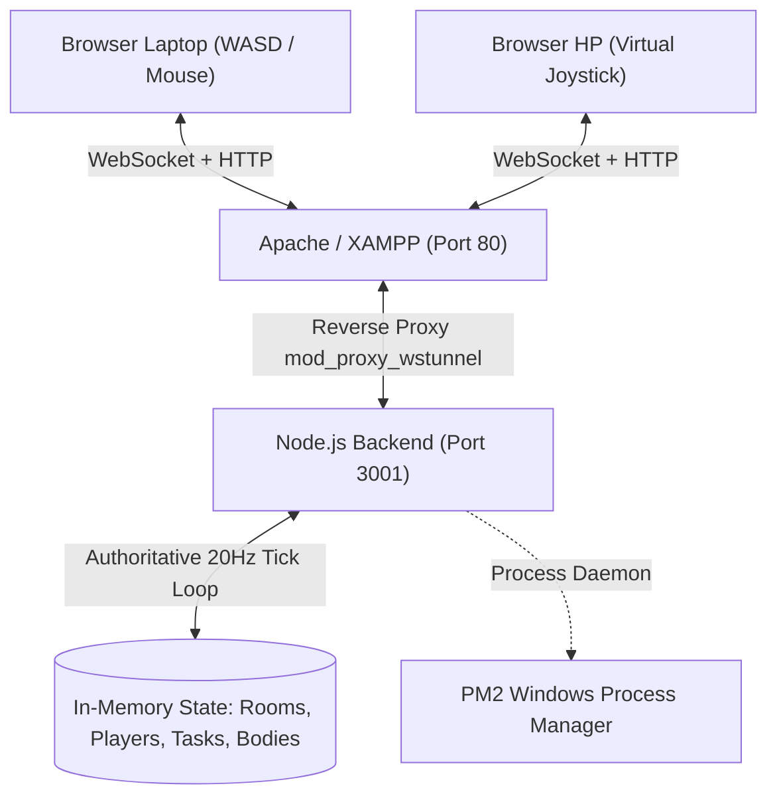

# 🤖 AGENTS.md - Panduan Kolaborasi & Pengembangan "Impostor Techno"

Dokumen ini ditujukan sebagai **panduan teknis komprehensif** bagi developer (manusia maupun AI Agent) untuk memahami arsitektur, standar desain, flow data, serta tata cara berkontribusi pada codebase **Impostor Techno**.

---

## 📌 1. Ringkasan Proyek & Lore

* **Nama Game**: Impostor Techno (Adaptasi Deduksi Sosial / Bergaya *"The Slacker / Si Gabut"*).
* **Tagline**: *"Server Down, Wi-Fi Putus, Siapa yang Nge-drop Database?!"*
* **Platform**: Web Multiplatform (Responsive Desktop / Laptop & Layar Sentuh HP/Tablet pada jaringan lokal LAN/Wi-Fi).
* **Visual Vibe**: 2.5D Isometric Retro-Cartoon Office & Cyber-Glassmorphism UI.
* **Peran (Roles)**:
  1. **The Engineers / Devs**:
     * Menyelesaikan 4 tugas sprint teknis kantor (Tasks) sebelum cascadal crash.
     * Mengidentifikasi Impostor melalui Emergency Meeting di meja War Room atau saat menemukan rekan yang terkena BSOD (Blue Screen).
  2. **The Impostor (Penyusup / Bug Maker)**:
     * Menyamar sebagai engineer sah, memalsukan aktivitas (fake tasks).
     * Melakukan **Silent Terminate / Slack** (meninggalkan laptop layar BSOD di lantai).
     * Memicu **Sabotase Kernel Panic** di Ruang Server.
     * Menyusup cepat antar-ruangan melalui **Server Rack Vent**.

---

## 🏗️ 2. Arsitektur Sistem & Tech Stack



* **Frontend**: Vanilla JavaScript (ES6+), HTML5 Canvas 2D API, Web Audio API synthesizer murni (tanpa dependensi file aset audio eksternal), CSS Cyber Glassmorphism.
* **Backend**: Node.js, Express, Socket.IO.
* **State Management**: Server-authoritative in-memory (`rooms` dictionary), sync snapshot broadcast 20Hz (`game_tick`).
* **Web Server / Reverse Proxy**: Apache HTTPD (XAMPP di Windows) dengan module `mod_proxy`, `mod_proxy_http`, `mod_proxy_wstunnel`, `mod_rewrite`.
* **Proses Manager**: PM2 (`impostor-techno`, Port internal default `3001`).

---

## 📁 3. Struktur Direktori

```text
impostor_techno/
├── public/                     # Static Frontend Assets
│   ├── index.html              # Struktur UI: Lobby, HUD, 4 Task Modals, Meeting Modal, Game Over
│   ├── style.css               # Cyber-glassmorphism, 2x2 retro action buttons, isometric canvas CSS
│   └── game.js                 # Client Game Engine: Canvas rendering, WASD/joystick input, audio synth
├── server.js                   # Authoritative backend: Room loop, collision, role assignment, win rules
├── package.json                # Dependencies: express, socket.io, cors, socket.io-client
├── httpd-vhosts.conf           # Konfigurasi Apache VirtualHost reverse proxy (Port 80 -> Port 3001)
├── PANDUAN_SETUP_XAMPP.md      # Panduan instalasi dan deployment jaringan lokal LAN XAMPP
├── README.md                   # Dokumentasi umum
└── AGENTS.md                   # Dokumen panduan ini
```

---

## 🗺️ 4. Denah Peta & Sistem Kolisi (Playable Map Geometry)

Peta berukuran **1400 x 1050 px**. Seluruh koordinat sinkron antara [server.js](file:///c:/GAME/impostor_techno/server.js) dan [public/game.js](file:///c:/GAME/impostor_techno/public/game.js).

### A. Batas Lantai (Walkable Area)
* Sumbu X: `70` s/d `1330` (`MAP_WIDTH - 70`)
* Sumbu Y: `90` s/d `980` (`MAP_HEIGHT - 70`)
* Karakter *Ghost* (pemain tereliminasi) dapat menembus seluruh dinding & rintangan.

### B. Daftar Solid Obstacles
Daftar perabot fisik yang tidak dapat ditembus oleh pemain hidup:
1. **Meja Rapat Incident War Room**: `{ x: 600, y: 180, w: 200, h: 80 }`
2. **Kubikel Dev Baris 1**: `{ x: 190, y: 340, w: 160, h: 70 }`
3. **Kubikel Dev Baris 2**: `{ x: 190, y: 520, w: 160, h: 70 }`
4. **Server Rack Alpha**: `{ x: 1080, y: 390, w: 70, h: 180 }`
5. **Server Rack Beta**: `{ x: 1180, y: 390, w: 70, h: 180 }`
6. **Meja Konter Pantry**: `{ x: 620, y: 810, w: 160, h: 60 }`
7. **Printer Rusak Berasap**: `{ x: 1230, y: 540, w: 46, h: 50 }`

### C. Lokasi Penting (Landmarks & Stations)
* **Emergency Meeting Alarm Button**: `{ x: 700, y: 220, radius: 150 }` (Di tengah meja War Room).
* **Task 1: Fix Switch & Patch Cord**: `{ x: 1250, y: 560, radius: 65 }` (Ruang Server).
* **Task 2: Deploy Hotfix ke Production**: `{ x: 180, y: 350, radius: 65 }` (Kubikel Dev).
* **Task 3: Restock Kopi Pantry**: `{ x: 550, y: 770, radius: 65 }` (Pantry & Galon Aqua).
* **Task 4: Restart Core Router**: `{ x: 1250, y: 330, radius: 65 }` (Ruang Server).
* **Sabotage Terminal (Kernel Panic)**: `{ x: 1060, y: 330, radius: 70 }` (Ruang Server).
* **Vents (Jalur Cepat Impostor)**:
  * `vent-server`: `{ x: 1240, y: 590 }`
  * `vent-dev`: `{ x: 170, y: 600 }`
  * `vent-pantry`: `{ x: 860, y: 920 }`

---

## 🎮 5. Input & Kontrol (UX Conventions)

* **Laptop / PC Keyboard**:
  * Gerak: `W`, `A`, `S`, `D` atau `ArrowUp`, `ArrowDown`, `ArrowLeft`, `ArrowRight`.
  * `Spacebar`: USE / Interaksi (Task, Tombol Rapat, Console Sabotase).
  * `R`: Report rekan yang terkena BSOD.
  * `Q`: Silent Terminate / Slack (Khusus Impostor).
  * `E` atau `V`: Masuk / Keluar Vent (Khusus Impostor).
* **Smartphone / Tablet (Touchscreen)**:
  * Jempol Kiri: Virtual On-Screen Joystick (`#joystick-zone`).
  * Jempol Kanan: Grid 2x2 Floating Action Buttons (`USE`, `▶ VENT`, `REPORT`, `SLACK`).
* **Direct Click-to-Move**:
  * Klik titik manapun pada lantai canvas untuk membuat karakter berjalan otomatis ke tujuan.
* **Auto-Blur Input Trap Protection**:
  * Ketika game dimulai, input form lobi otomatis di-*blur* agar keyboard WASD tidak dicegat oleh form teks.

---

## ⚡ 6. Socket.IO Protocol & Event Reference

| Event Name | Direction | Payload | Deskripsi |
| :--- | :--- | :--- | :--- |
| `create_room` | Client ➔ Server | `{ playerName, color }` | Membuat room baru 5-karakter |
| `join_room` | Client ➔ Server | `{ roomCode, playerName, color }` | Bergabung ke room yang ada |
| `add_bot` | Client ➔ Server | - | Menambahkan bot AI coworker ke lobi |
| `start_game` | Client ➔ Server | - | Host memulai game |
| `game_started` | Server ➔ Client | `{ role, tasks, spawnPos, ... }` | Mengirim peran rahasia & koordinat spawn aman |
| `player_move` | Client ➔ Server | `{ x, y, vx, vy, facing }` | Mengirim input pergerakan pemain |
| `game_tick` | Server ➔ Client | `{ state, players, bodies, sabotage, ... }` | Snapshot otoritatif 20Hz dari server |
| `complete_task` | Client ➔ Server | `{ taskId }` | Menyelesaikan mini-game task |
| `task_acknowledged`| Server ➔ Client | `{ taskId, tasksCompleted, totalProgress }` | Konfirmasi task selesai & update progress |
| `trigger_sabotage` | Client ➔ Server | `{ type: 'KERNEL_PANIC' }` | Mematikan listrik server (countdown 40s) |
| `repair_sabotage` | Client ➔ Server | - | Memperbaiki konsol server |
| `kill_target` | Client ➔ Server | `{ targetId }` | Impostor mengeliminasi target dalam 100px |
| `vent_action` | Client ➔ Server | `{ action: 'ENTER'\|'EXIT', ventId }` | Menyusup atau keluar jalur kabel vent |
| `call_meeting` | Client ➔ Server | `{ reason: 'BUTTON'\|'BODY', bodyId }` | Membuka antarmuka Incident War Room |
| `cast_vote` | Client ➔ Server | `{ targetId: pId \| 'SKIP' }` | Mengirim suara voting eliminasi |
| `meeting_chat` | Client ➔ Server | `{ text }` | Mengirim pesan tiket insiden saat meeting |
| `play_again` | Client ➔ Server | - | Mereset room kembali ke lobi untuk ronde baru |

---

## ⚙️ 7. Operasional & Perintah Maintenance (CLI)

Semua perintah dijalankan di direktori proyek `c:\GAME\impostor_techno` pada PowerShell:

### A. Menjalankan / Menghentikan PM2
```powershell
# Cek status proses
pm2 status

# Restart server game
pm2 restart impostor-techno

# Melihat log real-time
pm2 logs impostor-techno --lines 30

# Mematikan service sementara
pm2 stop impostor-techno

# Menghapus service dari PM2
pm2 delete impostor-techno

# Menyimpan konfigurasi PM2 saat ini
pm2 save
```

### B. Validasi Kode & Tes Sintaks
```powershell
# Cek sintaks backend
node -c server.js

# Cek sintaks frontend
node -c public/game.js

# Tes API endpoint status
Invoke-RestMethod -Uri "http://127.0.0.1:3001/api/status"
```

---

## ⚠️ 8. Aturan Wajib untuk Developer / AI Agent Lain

1. **Jaga Sinkronisasi Kolisi**:
   Jika Anda mengubah atau menambah perabot di `drawIsometricFurniture()` pada [public/game.js](file:///c:/GAME/impostor_techno/public/game.js), Anda **WAJIB** memperbarui array `OBSTACLES` di [server.js](file:///c:/GAME/impostor_techno/server.js) dan [public/game.js](file:///c:/GAME/impostor_techno/public/game.js) dengan dimensi yang sama.
2. **Jangan Menaruh Spawn di Dalam Bounding Box**:
   Semua titik spawn harus berada di luar bounding box meja konferensi (gunakan helper `getSpawnPosition`).
3. **Zero Audio Asset Dependency**:
   Jangan menambahkan file `.mp3` atau `.wav` lokal yang dapat memicu HTTP 404. Gunakan fungsi `playSound(type)` yang sudah terintegrasi dengan Web Audio API synthesizer.
4. **Pertahankan Grid Tombol 2x2**:
   Tombol aksi `#btn-action-use`, `#btn-action-vent`, `#btn-action-report`, dan `#btn-action-kill` harus tetap berada di DOM dalam grid 2x2 agar konsisten dengan gambar acuan retro komik ("The Slacker / Si Gabut"). Gunakan class `.disabled` untuk status tidak aktif, jangan gunakan `display: none` pada tombol utama.
5. **Port Fallback**:
   Port internal default adalah `3001` (karena port `3000` sering dipakai oleh proses lain pada environment host). Apache XAMPP dikonfigurasi meneruskan WebSocket ke port `3001`.
